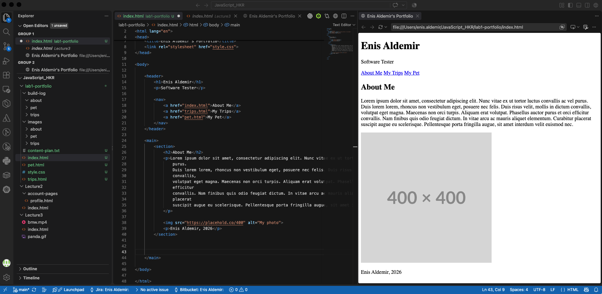
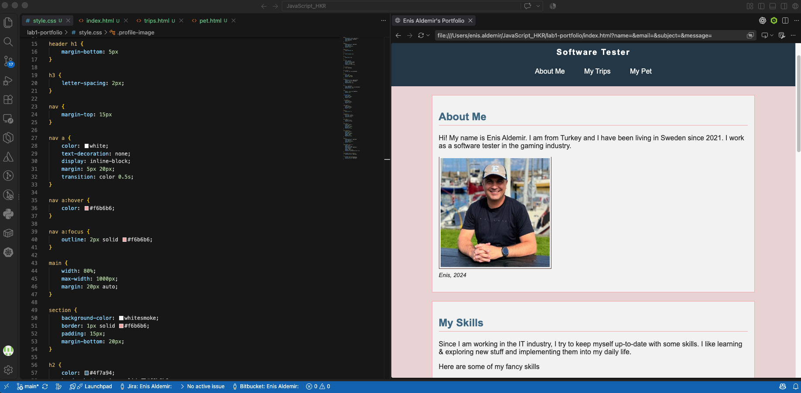
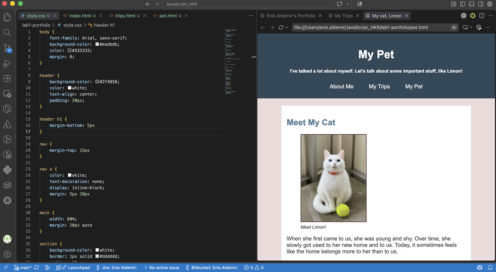
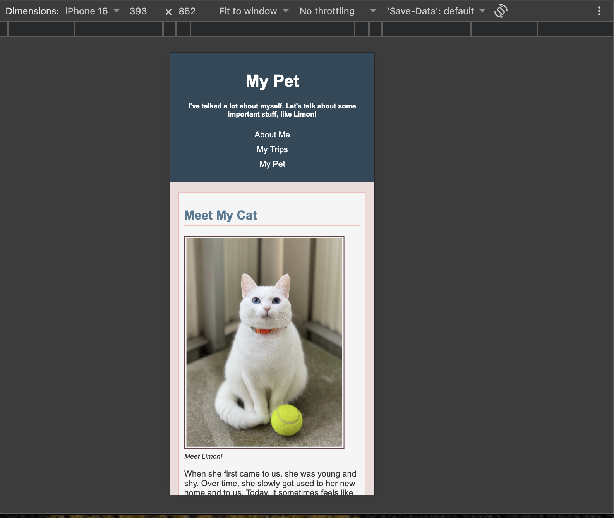
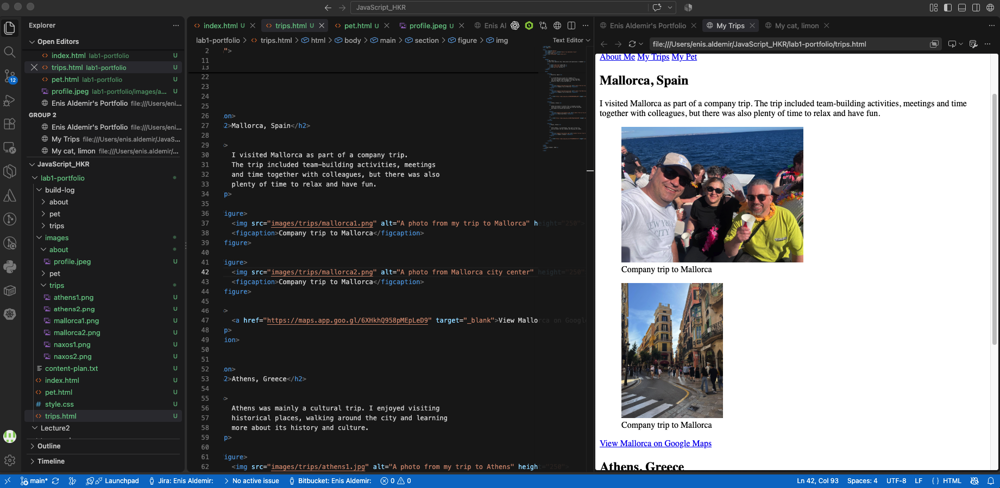
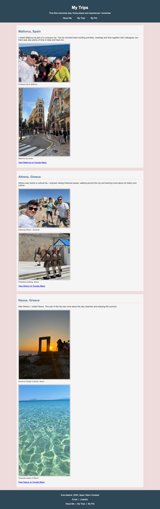
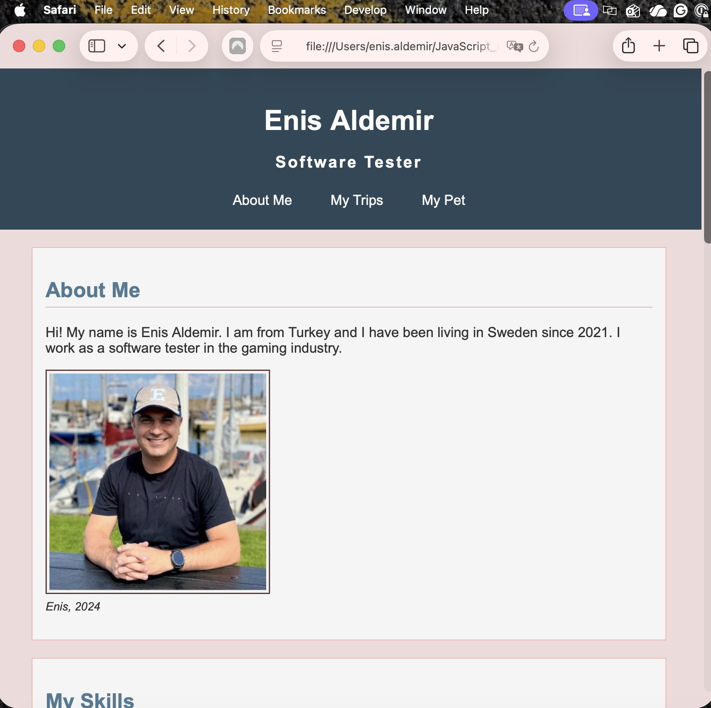
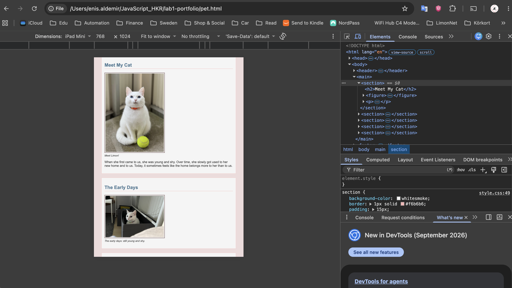
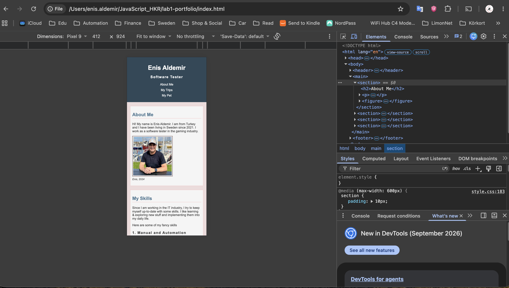

Enis Aldemir
# LAB_1 Development plan for the personal portfolio

- The progress evidence and changes are documented in the screenshots under `./build-log-screenshots`. 
- I put the screenshots in three separate folders matching the HTML pages. There you may see the evolution of the pages and progress of the project in details. 

## 1. Design process
###	1.1. Wireframe/sketch

		Page 1 - Index

            Name Surname
            Title
            Link 1 - Link 2 - Link 3

            About me:
                image (profile photo)
                small text about me

            My skills:
                Some of my skills
                    About my job and IT courses

            Experiences:
                Resume style short info

            Projects & Challenges:
                Two projects I worked and reflections

            Contact Me form

            Footer:
                Name, contact details, etc

		Page 2 - My Trips
            Link 1 - Link 2 - Link 3

            Mallorca work trip:
                Short paragraph
                Two images

            Athens trip:
                Short paragraph
                Two images

            Naxos trip:
                Short paragraph
                Two images

            Footer:
                Name, contact details, etc

		Page 3 - My Pet
            Link 1 - Link 2 - Link 3

            Info about Limon:
                Short paragraph
                Image

            Limon's early days:
                Short paragraph
                Image

            Limon is getting used to home:
                Short paragraph
                Image

            Limon feels at home:
                Short paragraph
                Image

            It's Limon's home from now on:
                Short paragraph
                Image				

            Footer:
                Name, contact details, etc

###	1.2. Color and typography
- Seed: `Warm Contrast`

#### Color
- I searched the web for warm colors and colors that could create contrast.
- I chose `soft pink` and `warm brown` as the warmer tones.
- I used `dark blue` and `blue-grey` to create contrast.
- I wanted the website to feel warm, but still be easy to read.

#### Typography
- I used `Arial`, because it is simple, familiar and easy to read.
- I did not use a decorative/fancy fonts, because they are hard to read, and also I wanted to keep the portfolio simple and clean.

###	1.3. Design decisions & changes

#### 1.3.1. Color design and improvements
Early phase of the project started with basic & default styling. I added warm pink and brown colors to match the seed, and did CSS styling for better looking pages. The later version looked more consistent and gave the three pages the same visual identity. 

**Before:**
- 

**After:**
-  

#### 1.3.2. Image sizing / resizing
- I started with placeholder images from https://placehold.co/ website. Then added images bit since their resolutions and sizes were different, they looked a bit ugly in the beginning. 
- Thus, in the CSS file I handled the image sizes (including max-width, height: auto)

#### 1.3.3. Responsive layout design for mobies
At first, the pages were designed mainly for desktop and they did not scale well in the mobile view. While testing with the Chrome DevTools mobile view, I noticed that the pages looked unscaled in the mobile layout. Thus, I added tablet and mobile queries to the CSS file. Also, on mobile, I changed the navigation panel to vertical, and adjusted width of images/forms accoringly. This made the pages easier to use and read on smaller screens.

During the design process, I tried to keep the website simple and not use too many different styles. My first idea was just to create the pages and put the necessary content inside them. But while the project was progressing, I saw that the three pages also needed to look connected to each other. Thus, I used the same colors, navigation panel, section styles, and footer structure in all pages. I also tried to keep the layout similar between the pages. These changes helped the website to look more consistent and made it easier for the user to understand that all three pages belong to the same portfolio.

**Before:**
- 

**After:**
-  

## 2. Code evolution

### 2.1. Early and Final HTML
- In the initial phase of the project, I first established the basic HTML structure of the pages. 
- At this stage, I focused more on content and page structure than on design. I created three separate pages using HTML tags such as `header`, `nav`, `main`, `section`, and `footer`. 
- Then, I added tags like `figure`, `figcaption`, and `article` where needed.
- The early versions of the pages were quite simple, with very limited visual layout. 
- During the development phase, I decided that all three pages to share the same navigation and footer structure. 
- By the end of the development process, the HTML structure had become more organized and readable.

**Before:**
- 

**After:**
-  

### 2.2. Meaningful code changes
- At first, I started hardcoding the width and height of the image files in the HTML files. As the number of images increased, I saw that maintaining the images and keeping them good-looking in the pages became difficult, because their sizes and resolutions were different. Thus I decided to control their sizes in the CSS file instead of separate HTML files. 

- The process started with a desktop design, so initially I did not need to think about readability. However while testing in the Chrome DevTools mobile view, I realized that the texts, forms, and images look ugly. Then I added two different media queries inside my CSS fie (900px for tablet layout / 600px for mobile layout) and I adjusted sizes and form areas inside them. I also changed the navigation panel view to portrait in mobile layout to make the navigation links easily reachable. With these changes, the HTML pages became more readable and usable.

- At the beginning of the project, navigation links were simple links, and it was difficult for the users to interact with them. To make them distinctive and easily noticeable, I added `:hover` and `:focus` states to them, and added a soft color `:transition` on them. I also added a similar pattern to the "send" button in the contact-me form. 

### 2.3. Technical problems and solutions
- Images were too large and did not scale correctly: The images that I added to the HTML pages were in different sizes and resolutions. First I tried to solve this problem with fixed `width` and `height` values inside the HTML files. But as I described above, it did not work well especially in the mobile layout. Then I controlled them with ratios in the CSS file which made them dynamic and responsive to the resolution. 

- While testing the page, I realized that the contact-me form was sending empty forms. While searching about HTML forms, I saw that there is a built-in verification method in HTML, and thus I added `required` to the name, email, subject, and message fields. This simple verification method helped me to solve the issue without requiring a Javascript verification method. 

- While testing the footer links, I realized that the email link was not working correctly. At first, I had written only the email address inside the href value. Then I learned that email links should use `mailto:` before the address. So I changed it to `href="mailto:enisaldemir0@gmail.com"`. After this change, clicking the Email link opened the default email application correctly.

## 3. Responsive breakdown
- I tested the website in three different screen sizes: desktop, tablet, and mobile. Since I started the project with a desktop layout, the default CSS rules are mainly designed for bigger screens. Then I added two media queries for tablet and mobile layouts. For desktop layout I used 1200px, for tablet layout it is 900px, and for mobile layout I used 600px.

- I did not change the navigation panel in the tablet layout, because there was still enough space to display the links horizontally. But in mobiles, I changed the navigation links from horizontal to portrait by using `display: block`. This placed the links under each other and made them easier to reach and read on mobile. I also reduced the header and heading sizes. 

**Desktop Layout:**
- 

**Tablet Layout:**
-  

**Mobile Layout:**
-  

## 4. Personal reflection
- The biggest change during the project was the responsive design. At first, I mostly focused on the desktop version. When I tested the pages in Chrome DevTools, I saw that the images, forms, and navigation did not look good on smaller screens. Because of this, I added separate tablet and mobile layouts and changed some sizes and positions.

- Using media queries and responsive images were life-savers. Also using the built-in verification function of the HTML for the forms were very helpful for 
error handling without spending much time. 

- If I had more time, I would improve the visual design a bit more and make the mobile version better. I wanted to keep the project simple, so I did not use very advanced layouts or animations. 
